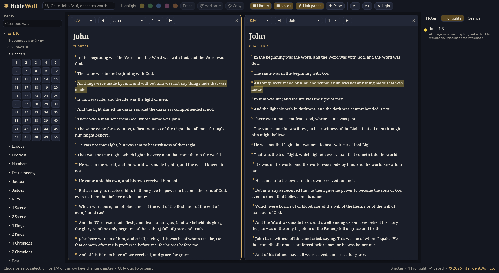

<div align="center">


# BibleWolf

**A fast, beautiful Bible study app for Windows, macOS and Linux.**
Read translations side by side, highlight verses, and stick notes on them like post-its.

[](https://github.com/intelligentwolf/biblewolf/actions/workflows/ci.yml)
[](https://github.com/intelligentwolf/biblewolf/releases/latest)
[](LICENSE)
[](https://discord.gg/S3wj882aQH)
[](https://github.com/sponsors/intelligentwolf)



</div>

## Features

- 📚 **Library tree.** Browse translation → book → chapter, with every chapter one click away.
- 🪟 **Side-by-side panes.** Open up to four translations at once. With **Link panes** on, they all follow the same chapter, and selecting a verse lines the others up on it.
- 🖍️ **Highlighters.** Five colours, applied from the toolbar, a right-click, or the keys **1–5**.
- 🗒️ **Sticky notes.** Notes float over the text like real post-its: drag them, resize them, recolour them, hide them and bring them back. A little marker beside each verse shows where a note is stuck, and the Notes panel lists them all.
- ✝️ **Red letters.** The words of Jesus are shown in red in the KJV and WEB. The colours are tuned to stay readable on the dark theme and on every highlighter colour, and the toggle is one click.
- 🎵 **For worship leaders.** Select a passage and BibleWolf suggests songs for it, from your own library and (optionally) from Hymnary.org's scripture index of traditional hymns. Plan services and set lists from readings, songs and other items, then copy them or save them to share with your team.
- 🔍 **Go to and search in one box.** Type `John 3:16`, `ps 23:1-4`, `1 cor 13` or just `Romans` to jump there, or type any words to search the whole translation.
- 🌗 **Dark "Midnight" and light "Parchment" themes.** Scripture is set in Noto Serif, and the text size is adjustable. Every text colour is tested to meet WCAG AA contrast.
- 💾 **Your notes are safe.** They save automatically and atomically. A damaged file is set aside and never overwritten, and a second open window can't clobber the first one's notes.
- 📦 **One self-contained app.** Nine translations are built in, and everything except the optional hymn lookup works offline.

## Download

Get the latest build from the **[Releases page](https://github.com/intelligentwolf/biblewolf/releases/latest)**:

| Platform | File | Install |
|---|---|---|
| **Windows** 10/11 (64-bit) | `…-windows-x86_64.zip` | Unzip and run `biblewolf.exe` |
| **macOS** 11+ (Apple Silicon & Intel) | `…-macos-universal.dmg` | Open the DMG and drag **BibleWolf** to Applications |
| **Linux** x86_64 / ARM64 | `…-linux-<arch>.tar.gz` | Extract and run `./install.sh` (installs to `~/.local`), or just run `./biblewolf` |

> **First launch on macOS / Windows.** The builds aren't code-signed yet, so the OS warns you the first time:
> - **macOS:** right-click **BibleWolf.app**, choose **Open**, then **Open** again. Alternatively run `xattr -dr com.apple.quarantine /Applications/BibleWolf.app`.
> - **Windows:** on the SmartScreen prompt, click **More info**, then **Run anyway**.
>
> Each release includes `SHA256SUMS.txt` so you can verify your download.

## Translations included

All are in the public domain:

| ID | Translation | Red letters |
|----|-------------|:---:|
| KJV | King James Version (1769), with translators' supplied words in *italics* | ✅ |
| WEB | World English Bible | ✅ |
| BSB | Berean Standard Bible | — |
| ASV | American Standard Version (1901) | — |
| NHEB | New Heart English Bible | — |
| YLT | Young's Literal Translation (1898) | — |
| Darby | Darby Bible (1889) | — |
| Webster | Webster Bible | — |
| Geneva1599 | Geneva Bible (1599) | — |

Red letters appear only where the source text marks the words of Jesus. BibleWolf never guesses them from quotation marks, which would sometimes colour the wrong speaker.

### Add more translations

BibleWolf reads the JSON format from [scrollmapper/bible_databases](https://github.com/scrollmapper/bible_databases), which has 140+ translations in many languages. Download any complete 66-book file from its `formats/json/` folder into your BibleWolf data folder's `bibles/` subfolder (see [Your data](#your-data)), then restart.

## Using it

| Do this | How |
|---|---|
| Open a chapter | Expand a translation and a book in the Library, then click a chapter number |
| Select verses | Click a verse; **Shift-click** another verse to select a range |
| Highlight | Pick a colour in the toolbar or press **1–5**. Press **0**, **Delete** or click **Erase** to remove it |
| Add a sticky note | **📝 Add note**, the **N** key, or right-click a verse |
| Re-open a hidden note | Click its marker beside the verse, or **Show** in the Notes panel |
| Undo deleting a note | **Undo** in the status bar |
| Copy verses | **Ctrl+C** (⌘C on macOS) or **📋 Copy** |
| Change chapter | **← / →** keys, the ◀ ▶ buttons, or the pickers in each pane's header |
| Go to / search | **Ctrl+K**, **Ctrl+F** or **/**, then type and press **Enter** |
| Search for a book name as a word | Put it in quotes: `"John"` |

Highlights and notes belong to the verse, not the translation, so a verse highlighted in the KJV is highlighted in the BSB too.

### Worship tools

Open the **🎵 Worship** side of the right-hand panel (or click **🎵 Songs** in the toolbar):

- **Songs** lists songs for the selected verses, or for the whole chapter if nothing is selected:
  - **Your songs** are songs from your library whose Bible references overlap the passage.
  - **Hymns from Hymnary.org** is a lookup in Hymnary's scripture index, with the most widely sung hymns first, linking to words and tunes. It is **off until you turn it on**; when on, only the Bible reference (e.g. "John 3:16") is sent.
- **My songs** is your band's repertoire: title, artist, key, tempo, CCLI number, Bible references, themes, a link (chords, video) and notes. You can filter by theme.
- **Services** are your service plans. Add readings (the selected passage), songs and other items such as "Welcome" or "Prayer", reorder them, and set each song's key. **📋 Copy** puts the whole plan, including the full text of the readings, on the clipboard; **💾 Save as file** writes it to `Documents/BibleWolf/`.

Sticky notes can carry **theme tags** too, and the Notes tab filters by them, so you can collect passages for "Easter" or "Lament".

## Your data

| OS | Folder |
|---|---|
| Linux | `~/.local/share/biblewolf/` |
| macOS | `~/Library/Application Support/biblewolf/` |
| Windows | `%APPDATA%\biblewolf\` |

- `annotations.json` holds your notes, highlights, song library and service plans. It's plain JSON, easy to back up or sync. Saves are atomic (temp file, fsync, rename).
- If the file can't be read, it's kept as `annotations.corrupt-<time>.json` and never overwritten.
- If entries point at impossible verses (e.g. after a hand edit), they're skipped and the original is copied to `annotations.invalid-<time>.json`.
- Only one window saves at a time (`biblewolf.lock`). A second window opens read-only and tells you so.
- Window layout and preferences are stored by the UI framework (on Linux, in the same folder).

## Build from source

You need [Rust](https://rustup.rs) 1.89 or newer.

```sh
git clone https://github.com/intelligentwolf/biblewolf.git
cd biblewolf
./run.sh            # or: cargo run --release
```

`./run.sh --debug` builds faster but runs slower.

On Linux, install the windowing headers first. On Debian/Ubuntu:

```sh
sudo apt install libxcb-render0-dev libxcb-shape0-dev libxcb-xfixes0-dev libxkbcommon-dev libgl1-mesa-dev libwayland-dev
```

Run the tests with `cargo test`. They cover translation loading, reference parsing, note storage and recovery, the single-window lock, and colour contrast.

### Project layout

```
src/main.rs      window setup
src/app.rs       UI: library tree, panes, highlighter, sticky notes, search, status bar
src/bible.rs     translation loading and reference parsing ("1 cor 13:4-7")
src/store.rs     notes & highlights persistence
src/theme.rs     palettes, fonts, contrast tests
tools/           converters for Bible data and the app icon
packaging/       Linux .desktop entry, macOS Info.plist
```

The built-in Bibles are stored as gzipped TSV. KJV and WEB are generated by `tools/convert_usfm.py` from [eBible.org](https://ebible.org) USFM, keeping the words of Jesus, the translators' supplied words and the psalm titles as inline styles. The rest are generated by `tools/convert_scrollmapper.py` from scrollmapper's JSON.

### Releasing

Bump `version` in `Cargo.toml`, commit, then tag and push:

```sh
git tag v0.2.0 && git push origin v0.2.0
```

GitHub Actions builds Windows, macOS (universal) and Linux (x86_64 + ARM64) packages and publishes them as a release.

## Community & support

- 💬 **Discord:** questions, ideas and feedback at [discord.gg/S3wj882aQH](https://discord.gg/S3wj882aQH)
- ♥ **Donate:** BibleWolf is free. If it helps you, please consider supporting it on [GitHub Sponsors](https://github.com/sponsors/intelligentwolf).

Both links are also in the app's status bar and its About window.

## Contributing

Issues and pull requests are welcome. Please run `cargo fmt`, `cargo clippy --all-targets -- -D warnings` and `cargo test` before opening a PR; CI checks all three on Linux, Windows and macOS.

## License

**BibleWolf** is © 2026 [IntelligentWolf Ltd](https://wolf.uk.com) and released under the [MIT License](LICENSE).

Bundled material keeps its own terms:
- Bible texts: public domain. KJV and WEB come from [eBible.org](https://ebible.org); the others from [scrollmapper/bible_databases](https://github.com/scrollmapper/bible_databases).
- Hymn suggestions: looked up live from [Hymnary.org](https://hymnary.org) when you turn that option on; no Hymnary data is bundled.
- Noto Serif fonts: [SIL Open Font License 1.1](assets/fonts/OFL.txt).
- The app icon is drawn from the Noto Emoji wolf: SIL Open Font License 1.1.
- Built with [egui](https://github.com/emilk/egui).
